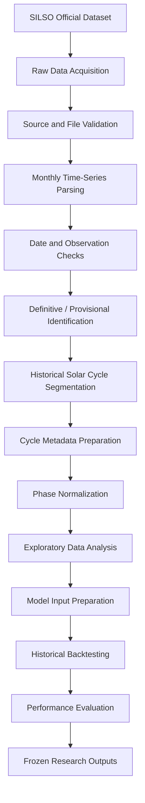
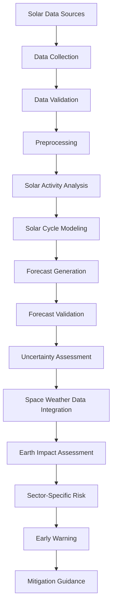
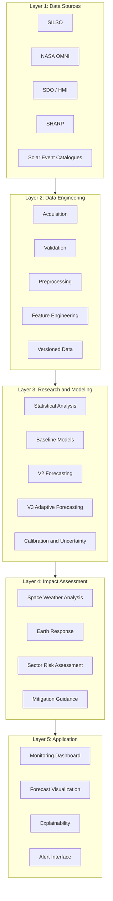
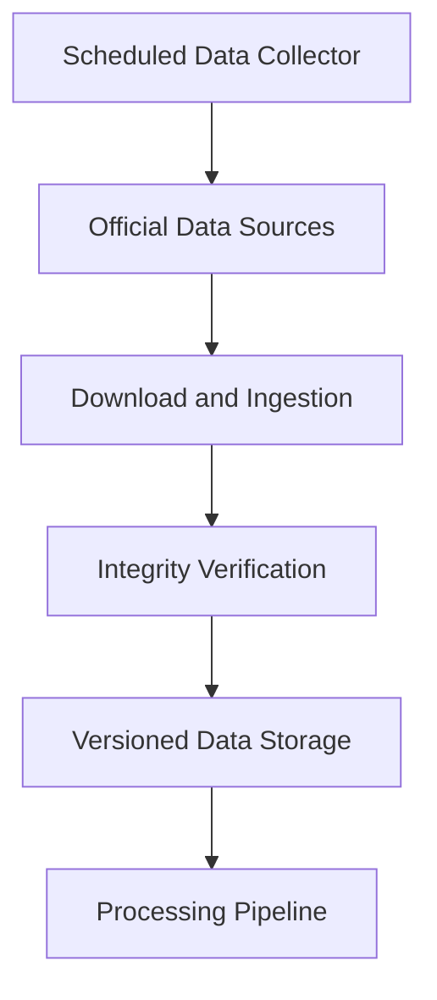

# SolarShield-AI
## Complete Project Overview & Technical Documentation

<p align="center">

**Predict the Sun. Understand the Risk. Prepare Earth.**

**AI-Driven Solar Activity Analysis, Space Weather Risk Assessment & Early Warning Research Platform**

Developed by **Team MU Solar Pulse**  
NASA Space Apps Challenge 2026 | Sylhet, Bangladesh

</p>

---

## Table of Contents

1. [Project Overview](#1-project-overview)
2. [Project Background and Problem Statement](#2-project-background-and-problem-statement)
3. [NASA Space Apps Challenge Alignment](#3-nasa-space-apps-challenge-alignment)
4. [Project Objectives](#4-project-objectives)
5. [Complete Development History](#5-complete-development-history)
6. [Data Sources and Datasets](#6-data-sources-and-datasets)
7. [Data Collection and Processing Workflow](#7-data-collection-and-processing-workflow)
8. [Tools, Technologies and Development Environment](#8-tools-technologies-and-development-environment)
9. [Statistical Analysis and Research Methods](#9-statistical-analysis-and-research-methods)
10. [Machine Learning Models and Algorithms](#10-machine-learning-models-and-algorithms)
11. [Model Experimentation and Performance Evaluation](#11-model-experimentation-and-performance-evaluation)
12. [SolarShield-AI V2 Research](#12-solarshield-ai-v2-research)
13. [SolarShield-AI V3 Research](#13-solarshield-ai-v3-research)
14. [Solar Activity Monitoring and Prediction Workflow](#14-solar-activity-monitoring-and-prediction-workflow)
15. [System Architecture](#15-system-architecture)
16. [Explainable AI and Scientific Reliability](#16-explainable-ai-and-scientific-reliability)
17. [Current Development Status](#17-current-development-status)
18. [Project Strengths and Limitations](#18-project-strengths-and-limitations)
19. [Future Development and Automation Roadmap](#19-future-development-and-automation-roadmap)
20. [Potential Applications and Expected Impact](#20-potential-applications-and-expected-impact)
21. [Research Reproducibility and Data Governance](#21-research-reproducibility-and-data-governance)
22. [Repository Structure](#22-repository-structure)
23. [Team and Contributions](#23-team-and-contributions)
24. [References and Technical Resources](#24-references-and-technical-resources)
25. [Disclaimer](#25-disclaimer)

---

# 1. Project Overview

**SolarShield-AI** is a research-oriented artificial intelligence and space weather risk assessment project developed by Team MU Solar Pulse for the NASA Space Apps Challenge 2026.

The project investigates how historical and ongoing solar activity can be analyzed, modeled, and translated into meaningful information about potential space weather conditions and their possible consequences for Earth-based technological infrastructure.

Solar activity is a continuously evolving phenomenon. Changes in solar magnetic activity, sunspots, solar flares, coronal mass ejections (CMEs), and solar wind conditions can contribute to disturbances in Earth's magnetosphere and ionosphere.

These disturbances may affect:

- Satellites and spacecraft.
- Global Navigation Satellite Systems (GNSS).
- GPS positioning and timing.
- Radio and satellite communications.
- Aviation communication and navigation.
- Electrical power infrastructure.
- Space-based scientific instruments.

SolarShield-AI aims to develop a research-driven framework that connects solar activity observations with space weather analysis, risk assessment, forecasting, and actionable early-warning information.

### Core Concept

The overall research and system concept follows this pipeline:

**Solar Activity → Space Weather → Earth Response → Risk Assessment → Early Warning → Mitigation**

The project combines long-term solar observations, statistical analysis, historical backtesting, machine learning experimentation, and explainability-oriented research.

Rather than presenting an unvalidated prediction as a guaranteed forecast, SolarShield-AI emphasizes reproducibility, uncertainty awareness, historical validation, and scientifically responsible interpretation.

### Project Identity

| Attribute | Information |
|---|---|
| Project Name | SolarShield-AI |
| Project Category | AI, Machine Learning, Solar Physics, Space Weather |
| Competition | NASA Space Apps Challenge 2026 |
| Challenge | Be An Earth System Trend Detective! |
| Team | Team MU Solar Pulse |
| Location | Sylhet, Bangladesh |
| Primary Dataset | SILSO International Sunspot Number |
| Main Research Direction | Solar Cycle Analysis and Forecasting |
| Research Versions | V1, V2 and V3 |
| Current Research Stage | V3 verification and execution preparation |
| Project Type | Research Prototype and Early-Warning System Development |

---

# 2. Project Background and Problem Statement

## 2.1 Background

The Sun is the primary energy source for Earth's environment. Its magnetic activity changes over time, producing solar cycles and various transient phenomena.

The approximately 11-year solar cycle is characterized by changes in sunspot activity. During periods of increased activity, solar flares and coronal mass ejections may become more frequent.

Some of these events can interact with Earth's magnetosphere, producing geomagnetic disturbances.

However, understanding solar activity and predicting its consequences are different research problems.

A prediction of sunspot activity does not automatically constitute a prediction of a solar flare, CME, geomagnetic storm, or infrastructure failure.

SolarShield-AI therefore treats solar activity forecasting and Earth-level impact assessment as connected but scientifically distinct stages.

## 2.2 Problem Statement

The central problem is the difficulty of translating complex solar observations and space weather information into understandable, sector-specific risk information.

Several challenges motivate this research:

1. Solar activity changes over multiple timescales.
2. Long-term solar cycles are not perfectly periodic.
3. Solar observations contain noise, uncertainty, and provisional measurements.
4. Solar activity alone cannot establish the severity of an Earth-directed event.
5. Space weather information must be translated into operationally meaningful indicators.
6. Forecasting models require rigorous historical evaluation.
7. Warning systems must communicate uncertainty instead of presenting false certainty.

## 2.3 Proposed Solution

SolarShield-AI proposes an integrated analytical framework with six major components:

1. Solar activity data collection.
2. Historical trend and cycle analysis.
3. Solar activity forecasting.
4. Space weather condition assessment.
5. Earth-impact and sector-specific risk interpretation.
6. Early-warning and mitigation recommendations.

The current research foundation primarily focuses on historical solar-cycle data, forecasting methodology, and reproducible model evaluation.

The complete operational space weather warning pipeline remains a development objective rather than a fully validated capability.

---

# 3. NASA Space Apps Challenge Alignment

SolarShield-AI is aligned with the 2026 NASA Space Apps Challenge theme:

**Be An Earth System Trend Detective!**

The project investigates long-term solar activity trends and their potential relevance to Earth's technological environment.

Its research direction involves:

- Analyzing long-term solar observations.
- Identifying historical changes in solar activity.
- Investigating solar-cycle behavior.
- Measuring trends and variations.
- Developing forecasting methodologies.
- Evaluating predictive performance.
- Exploring the relationship between solar activity and Earth-system risks.

### Research Alignment

| Challenge-oriented concept | SolarShield-AI implementation |
|---|---|
| Historical scientific observations | SILSO monthly sunspot records |
| Long-term trend analysis | Historical solar activity analysis |
| Temporal pattern identification | Solar-cycle decomposition and phase normalization |
| Statistical investigation | Autocorrelation and forecasting diagnostics |
| Predictive analysis | Baseline, spline and cycle-conditioned models |
| Scientific reliability | Historical backtesting and frozen experiments |
| Interpretation | Explainability and uncertainty analysis |
| Societal relevance | Potential satellite, communication and power-grid applications |

The project distinguishes between solar-origin observations and downstream Earth-system consequences. This distinction is essential for scientifically accurate challenge alignment.

---

# 4. Project Objectives

## 4.1 Primary Objectives

- Build a reproducible historical solar activity dataset.
- Investigate the characteristics of solar cycles.
- Analyze temporal trends and variations.
- Develop and evaluate solar-cycle forecasting models.
- Compare statistical and machine learning approaches.
- Investigate amplitude and shape differences between solar cycles.
- Develop adaptive forecasting methodologies.
- Explore physical and data-driven model integration.
- Investigate the potential use of solar observations for space weather risk assessment.

## 4.2 Long-Term Objectives

- Integrate multiple solar and space weather datasets.
- Develop continuous data ingestion.
- Generate updated forecasts.
- Introduce calibrated probabilistic risk assessments.
- Develop sector-specific warning information.
- Validate outputs with relevant scientific and operational partners.
- Develop an explainable monitoring dashboard.

---

# 5. Complete Development History

SolarShield-AI has evolved from an initial conceptual proposal into a more rigorous research and model-development project.

The following history separates conceptual development, executed experiments, and future work.

## 5.1 Initial Concept Development

The initial concept established the relationship between solar activity, space weather, Earth-system impacts, and early warnings.

The proposed technical direction included:

- Solar activity monitoring.
- Historical solar-cycle analysis.
- Machine learning-based forecasting.
- Space weather assessment.
- Risk classification.
- Explainable alerts.
- A web-based monitoring interface.

Candidate datasets and algorithms were investigated at the design stage.

Not every initially proposed model or data source was subsequently implemented.

## 5.2 Research Foundation and Dataset Preparation

The project established SILSO International Sunspot Number as its primary long-term historical dataset.

The research dataset contains:

| Property | Verified project record |
|---|---|
| Dataset | SILSO monthly total sunspot number |
| Start | January 1749 |
| End | September 2026 |
| Number of observations | 3,333 |
| Historical cycles | Solar Cycles 1–24 |
| Ongoing cycle | Solar Cycle 25 |
| Latest provisional period | July–September 2026 |

The research included:

- Historical data preparation.
- Monthly time-series organization.
- Solar-cycle boundary handling.
- Exploratory data analysis.
- Autocorrelation investigation.
- Forecasting baseline development.
- Historical evaluation design.

The dataset's provisional observations were treated separately from definitive historical observations.

## 5.3 Initial Forecasting Baselines

Two simple forecasting approaches were implemented:

**Persistence baseline**

Uses the latest available observation as the forecast reference.

**Seasonal-naive baseline**

Uses a previous seasonal observation as the forecast reference.

The historical evaluation covered 129 forecast evaluations from January 2016 through September 2026.

The results indicated that persistence generally performed better than seasonal-naive forecasting, except at the 12-month horizon, where their performance was equal.

These baselines established an important reference for subsequent experiments.

## 5.4 ARIMA Experiment

An ARIMA/SARIMA research experiment was conducted using temporally separated model-selection and confirmation periods.

| Experiment component | Configuration |
|---|---|
| Selection period | 1976–1995 |
| Confirmation period | 1996–2015 |
| Evaluation strategy | Quarterly forecast origins |
| Main comparison | MAE relative to reference |
| Best MAE ratio | 0.9663539769 |
| Qualification threshold | 0.95 |

The experiment did not satisfy the predefined qualification threshold.

**Result: No ARIMA/SARIMA model qualified for acceptance.**

This experiment demonstrated that conventional autoregressive forecasting was not sufficiently competitive under the project's evaluation protocol.

## 5.5 V2 Research Development

The second major research phase introduced more advanced solar-cycle modeling approaches.

Three major research milestones were established:

- V2-004: Phase-median baseline.
- V2-006: Constrained cubic B-spline.
- V2-007: Amplitude-aware forecasting.

Their detailed results are documented in Section 12.

## 5.6 V3 Research Development

The third research phase introduced a more adaptive forecasting direction.

Its principles include:

1. Adaptive correction using early observed portions of a solar cycle.
2. Repeated observation assimilation.
3. Physical solar dynamo/Babcock–Leighton modeling as a potential future research component.
4. Machine learning residual modeling.
5. Dynamic Time Warping (DTW)-based shape-aware investigation.

An exploratory V3 run was completed, followed by a more controlled development and verification process.

Detailed records are provided in Section 13.

---

# 6. Data Sources and Datasets

Data provenance is a fundamental component of SolarShield-AI.

The project distinguishes between:

- Datasets directly used in completed experiments.
- Datasets inspected or downloaded experimentally.
- External sources identified for future integration.

## 6.1 Primary Dataset: SILSO

**Source:** World Data Center SILSO, Royal Observatory of Belgium.

Official resource:

https://www.sidc.be/SILSO/datafiles

Monthly sunspot information:

https://www.sidc.be/SILSO/infosnmtot

The International Sunspot Number is the primary historical dataset used for the project's long-term solar-cycle forecasting experiments.

### Dataset Information

- Monthly total sunspot numbers.
- Historical coverage beginning in 1749.
- Solar-cycle maxima and minima.
- Definitive and provisional data indicators.
- Associated observational uncertainty information.

### Project Usage

SILSO was used for:

- Historical solar activity reconstruction.
- Solar-cycle segmentation.
- Exploratory data analysis.
- Phase normalization.
- Forecasting experiments.
- Historical backtesting.
- Cycle-conditioned forecasting.
- Cycle 25 analysis.

### Data Policy

The SILSO data page identifies its data policy as CC BY-NC. The applicable attribution and usage terms must be preserved when redistributing derived datasets or visualizations.

## 6.2 NASA OMNI Dataset

**Source:** NASA Space Physics Data Facility.

Official OMNIWeb:

https://omniweb.gsfc.nasa.gov/ow.html

NASA Open Data:

https://data.nasa.gov/dataset/omni-hourly-data-set

OMNI provides near-Earth solar wind, magnetic field, plasma, energetic particle and geomagnetic information.

Relevant variables include:

- Interplanetary Magnetic Field (IMF).
- IMF Bz.
- Solar wind speed.
- Solar wind density.
- Solar wind temperature.
- Kp index.
- Dst index.
- AE, AU and AL indices.
- F10.7 solar radio flux.

**Project status:** Identified as a relevant space weather data source. Full operational integration into the forecasting pipeline is not yet established.

## 6.3 Solar Dynamics Observatory (SDO)

**Mission:** NASA Solar Dynamics Observatory.

Official mission:

https://science.nasa.gov/mission/sdo/

SDO provides solar observations that can support more detailed solar magnetic activity research.

## 6.4 Helioseismic and Magnetic Imager (HMI)

HMI is an instrument aboard SDO.

Relevant data series investigated:

- `hmi.M_720s`
- `hmi.sharp_cea_720s`

The project explored these sources to investigate solar magnetic field information and active-region properties.

Official SHARP data documentation:

http://jsoc.stanford.edu/doc/data/hmi/sharp/sharp.htm

NASA SHARP dataset catalogue:

https://catalog.data.gov/dataset/sharp-cylindrical-equal-area-data

### HMI Data Investigation

The planned research direction uses daily selected observations rather than downloading every 12-minute observation indiscriminately.

The investigation includes:

- FITS data retrieval.
- Active-region information.
- HARP records.
- Magnetic-field-related parameters.
- Potential feature extraction.

The `720s` data series represents a 12-minute observation cadence. Daily sampling is a proposed reduction strategy, not a claim that all HMI observations have already been processed into a production-ready daily dataset.

## 6.5 HMI Experimental Data Inventory

The following experimental data records are available in the project's reported development history:

| Data item | Recorded status |
|---|---|
| FITS export test | 9 files |
| HARP CSV | 219,686 rows |
| HMI active-region investigation | Conducted |
| Complete daily HMI processing pipeline | Not yet confirmed |
| HMI integration into final V3 forecasting | Not established |

## 6.6 Historical Sunspot Group Archive

An additional investigation examined historical sunspot group records.

Reported audit results:

| Property | Result |
|---|---:|
| Archive coverage | 1874–2025 |
| Number of files | 152 |
| Number of records | 257,852 |
| Record width | 74 characters |
| Identified schema changes | 1977 and 1982 |

The investigation also included:

- File-level structural auditing.
- Record validation.
- Schema-change identification.
- CMD-related forensic filtering.
- Target identification.

A total of 57 targets were identified after filtering.

An official MissingDays download attempt encountered an anti-bot restriction.

**Status:** Historical archive investigation completed at the reported audit level; full integration into the main forecasting pipeline is not confirmed.

## 6.7 Data Source Classification

| Data source | Research purpose | Status |
|---|---|---|
| SILSO monthly sunspot number | Historical solar-cycle modeling | Used |
| NASA OMNI | Near-Earth space weather | Identified for integration |
| SDO/HMI | Solar magnetic observations | Experimentally investigated |
| SHARP CEA | Active-region magnetic parameters | Experimentally investigated |
| Sunspot group archive | Historical group-level analysis | Audited |
| MissingDays resource | Historical data completeness investigation | Download blocked |
| NASA solar imagery | Scientific visualization | Proposed for presentation |
| Other solar flare/CME catalogues | Event-level analysis | Integration not confirmed |

---

# 7. Data Collection and Processing Workflow

The project's data engineering workflow is designed to preserve scientific traceability.

## 7.1 Primary SILSO Processing Pipeline



## 7.2 Data Validation

The project applies controlled validation to ensure that:

- Dates are correctly ordered.
- Historical observations are not duplicated.
- Solar-cycle boundaries follow the defined metadata.
- Provisional observations are distinguishable.
- Source files remain identifiable.
- Data hashes can be compared across research stages.

## 7.3 Solar-Cycle Segmentation

Completed solar cycles 1–24 were reconstructed using official cycle boundary information.

The segmentation procedure follows these rules:

- The published minimum is included in the relevant cycle.
- The next published minimum is excluded.
- Cycle 25 is treated separately because it is ongoing.
- Completed-cycle curves are used for comparative modeling.

## 7.4 Phase Normalization

The completed historical cycles were transformed into normalized phase representations.

The current V2-007 preparation records include:

- 24 completed solar-cycle curves.
- 121 normalized phase points per cycle.
- Outer evaluation folds covering cycles 6–24.

Phase normalization makes it possible to compare solar cycles with different durations.

## 7.5 Data Integrity and Hashing

Frozen input records include SHA-256 hashes.

Latest reported V2-007 input hashes:

| Input | Recorded hash prefix/suffix |
|---|---|
| Monthly SILSO dataset | `8920e24…d194` |
| Cycle summary | `3f2a85…33ac` |

The complete hashes are retained in the original frozen experiment records and should be referenced directly rather than reconstructed from abbreviated values.

---

# 8. Tools, Technologies and Development Environment

This section distinguishes verified development tools from technologies that were only proposed or are awaiting inventory verification.

## 8.1 Operating System

**Windows 11**

The primary research environment is Windows 11.

## 8.2 Programming Language

**Python**

Python is the primary programming language used for the project's research, data processing, modeling and validation workflows.

Recorded environment versions:

| Environment | Python version |
|---|---|
| Main environment | Python 3.15.1 |
| Astrophysics virtual environment | Python 3.14.10 |

## 8.3 Development Environment

| Tool | Role |
|---|---|
| Windows PowerShell | Command execution and workflow control |
| Python | Data analysis and model development |
| Python virtual environment | Dependency isolation |
| Local project workspace | Research files and experiment outputs |
| Windows filesystem | Data and artifact organization |

Primary workspace:

```text
R:\SolarShield AI
```

## 8.4 Verified Scientific Libraries

| Library | Version | Role |
|---|---|---|
| Astropy | 8.0.2 | Astronomy and astrophysical data handling |
| SunPy | 8.0.1 | Solar physics data and analysis ecosystem |

These versions are associated with the project's dedicated astrophysics environment.

Official documentation:

- Astropy: https://docs.astropy.org/
- SunPy: https://docs.sunpy.org/

## 8.5 FITS and Solar Data Infrastructure

The project investigated FITS-based HMI data and JSOC data series.

Relevant infrastructure:

- NASA SDO/HMI.
- Stanford Joint Science Operations Center (JSOC).
- FITS astronomical data format.
- HMI active-region data products.

Additional package-level dependency records should be extracted from the actual environment files before publishing a complete `requirements.txt`.

## 8.6 Other Tools and Technologies

The following inventory is not yet complete:

| Technology | Status |
|---|---|
| Python | Confirmed |
| PowerShell | Confirmed |
| Astropy | Confirmed |
| SunPy | Confirmed |
| FITS data | Experimentally used |
| JSOC data infrastructure | Investigated |
| Git | Exact project usage not verified |
| GitHub | Repository URL not verified |
| NumPy | Dependency inventory required |
| Pandas | Dependency inventory required |
| SciPy | Dependency inventory required |
| Scikit-learn | Dependency inventory required |
| Matplotlib | Dependency inventory required |
| SHAP package | Installation and direct usage not confirmed |
| TensorFlow | Not confirmed |
| PyTorch | Not confirmed |
| XGBoost | Not confirmed |
| LightGBM | Not confirmed |

A library must not be described as an implemented dependency solely because it is commonly used for a particular algorithm.

---

# 9. Statistical Analysis and Research Methods

## 9.1 Exploratory Data Analysis

The project investigated the statistical behavior of historical sunspot observations.

The reported lag-1 autocorrelation is approximately:

```text
0.887
```

This indicates strong temporal dependence in the analyzed monthly series.

The EDA also supports:

- Solar-cycle comparisons.
- Long-term temporal investigation.
- Historical variation analysis.
- Model input diagnostics.
- Baseline construction.

## 9.2 Time-Series Evaluation

Historical forecasting must respect temporal ordering.

The project uses historical training and evaluation periods rather than randomly mixing future and past observations.

This reduces the risk of information leakage.

## 9.3 Performance Metrics

The research uses forecasting metrics including:

| Metric | Purpose |
|---|---|
| MAE | Average absolute prediction error |
| RMSE | Penalizes larger prediction errors |
| MAPE | Relative percentage error, where appropriate |
| R² | Measures explained variance, where appropriate |

For probabilistic forecasting and classification-oriented extensions, additional metrics are planned or identified:

- Brier Score.
- ROC-AUC.
- PR-AUC.
- F1-score.
- Calibration assessment.
- Prediction interval coverage.

These additional metrics should only be reported when the corresponding probabilistic or classification experiments have actually been executed.

## 9.4 Trend Analysis

Trend analysis is an important part of the project's challenge alignment.

Potential statistical approaches include:

- Mann-Kendall trend testing.
- Sen's slope.
- Autocorrelation analysis.
- Change-point investigation.

Mann-Kendall and related techniques are part of the research methodology direction. Their execution status should be verified against the corresponding experiment records before being presented as completed results.

---

# 10. Machine Learning Models and Algorithms

The project has explored several forecasting approaches at different research stages.

## 10.1 Implemented and Experimentally Evaluated Models

| Model | Category | Research purpose |
|---|---|---|
| Persistence | Baseline | Reference forecasting |
| Seasonal-naive | Baseline | Seasonal reference comparison |
| ARIMA/SARIMA | Statistical time series | Autoregressive forecasting |
| Phase-median | Solar-cycle baseline | Typical normalized cycle shape |
| Constrained cubic B-spline | Curve modeling | Smooth cycle reconstruction |
| Amplitude-aware models | Cycle-conditioned forecasting | Account for cycle amplitude differences |
| T0/T1/T2 | V3 cycle-conditioned methods | Compare baseline and adaptive forecasting |

## 10.2 Candidate Models Considered During Initial Design

The initial conceptual design also identified:

- Random Forest.
- XGBoost.
- LightGBM.
- Support Vector Regression.
- LSTM.
- GRU.
- Temporal Convolutional Networks.
- Transformer architectures.

These should be classified as candidate approaches unless their implementation and execution can be verified from the experiment records.

## 10.3 Physical Modeling Direction

The V3 research direction includes a potential combination of:

- Babcock–Leighton solar dynamo concepts.
- Physical solar-cycle modeling.
- Machine learning residual correction.
- Adaptive data assimilation.

This is a research direction, not a claim that a complete physical dynamo model has already been integrated into the production system.

---

# 11. Model Experimentation and Performance Evaluation

The project follows a research-oriented model development process.

Each experiment should preserve:

- Model configuration.
- Input data identity.
- Training and evaluation boundaries.
- Forecast outputs.
- Fold-level metrics.
- Diagnostic records.
- Execution logs.
- Freeze manifests.
- Validation results.

## 11.1 Evaluation Strategy

The V2 research uses outer evaluation folds covering solar cycles 6–24.

This creates 19 historical evaluation folds.

The models are compared against predefined performance limits.

The limits are:

| Metric | Acceptance limit |
|---|---:|
| MAE | 30.671873 |
| RMSE | 47.308740 |

These thresholds belong to the specified V2 evaluation protocol and should not automatically be applied to unrelated experiments.

## 11.2 Model Comparison Principles

A model should not be accepted merely because it performs better than another experimental candidate.

Acceptance depends on the predefined evaluation protocol.

The project distinguishes:

1. Best-performing candidate.
2. Candidate meeting a metric threshold.
3. Scientifically accepted model.
4. Production-ready model.

These are not interchangeable categories.

---

# 12. SolarShield-AI V2 Research

V2 represents a major improvement in controlled historical forecasting research.

## 12.1 V2-004: Phase-Median Baseline

**Purpose:** Establish a normalized historical solar-cycle reference.

The model uses the median phase behavior of historical solar cycles to construct a baseline forecast.

Reported results:

| Metric | Result |
|---|---:|
| MAE | 32.28618221690591 |
| RMSE | 43.007945798589034 |
| Evaluation folds | 19/19 |

V2-004 became the C2/reference model for subsequent comparisons.

## 12.2 V2-006: Constrained Cubic B-Spline

**Purpose:** Investigate whether smooth curve modeling can improve solar-cycle forecasting.

The model used constrained cubic B-spline modeling.

The approved global regularization parameter was:

```text
lambda = 0.0001
```

This parameter was used globally across the outer folds, rather than selected separately for each fold.

Reported results:

| Metric | Result |
|---|---:|
| MAE | 32.897583063120 |
| RMSE | 43.207453 |
| Evaluation folds | 19/19 |
| MAE threshold | Not met |
| RMSE threshold | Met |
| Final decision | Not accepted |

### Key Findings

The model did not satisfy the MAE acceptance limit.

Earlier diagnostics identified attenuation problems in the peak regions of Cycles 17, 19 and 21, along with higher errors in the second-quarter phase region.

The experiment was frozen and closed without modification.

No rerun or historical result alteration is authorized.

## 12.3 V2-007: Amplitude-Aware Forecasting

**Purpose:** Investigate whether explicitly accounting for cycle amplitude can improve forecasting performance.

V2-007 evaluated seven candidates.

The experiment used:

- 19 outer folds.
- Solar Cycles 6–24.
- Seven candidate configurations.
- 133 fold-level metric and amplitude records.
- 16,093 curve prediction and shape diagnostic records.
- 16093 curve-related records across the two corresponding output groups.

The experiment completed with no reported duplicate or failed fold records.

### Candidate Results

| Candidate | MAE | RMSE | Final interpretation |
|---|---:|---:|---|
| A1-S1 | 40.061081 | 51.255516 | Primary candidate; not accepted |
| A2-S1 | 39.605292 | 50.914046 | Not accepted |
| A3-S1 | 40.928021 | 52.102782 | Not accepted |
| A4-S1 | 37.885980 | 48.740444 | Best challenger; not accepted |
| A1-S2 | 45.256044 | 55.976587 | Not accepted |
| A1-S3 | 43.292634 | 54.020653 | Not accepted |
| A1-S4 | 41.256814 | 52.154874 | Not accepted |

### Best Challenger

A4-S1 achieved the lowest MAE among the evaluated candidates.

However:

- Its MAE exceeded the acceptance limit.
- Its RMSE exceeded the acceptance limit.
- It was not accepted as a replacement model.

Therefore, A4-S1 is classified as the best-performing challenger, not an accepted model.

### Additional Diagnostics

A decomposition report was completed on 4 November 2026.

The reconstruction error was approximately:

```text
2.8 × 10^-14
```

The reported Shapley summary included:

| Candidate | Amplitude contribution | Shape contribution |
|---|---:|---:|
| A4-S1 | 14.5644 | 23.3216 |
| A1-S1 | 16.1883 | 23.8728 |

These diagnostics provide additional information about the contribution of amplitude and shape components to prediction error.

### V2-007 Final Decision

**Status: NOT MET — Frozen and preserved unchanged.**

The experiment must not be rerun simply to obtain a different result.

Its frozen snapshot is recorded at:

```text
reports/model_development_v2/freezes/
V2-007_results_20261106_045443
```

The expected manifest hash is retained in the original frozen record.

---

# 13. SolarShield-AI V3 Research

V3 introduces a more adaptive and cycle-conditioned forecasting strategy.

Its main motivation is that solar cycles differ in duration, amplitude, shape, and temporal evolution.

A single fixed historical template may therefore be insufficient.

## 13.1 V3 Research Principles

The current V3 direction preserves three major ideas.

### Principle 1: Adaptive Correction

Use the first two to three years of an observed rising phase to adapt the forecast.

The model should be capable of incorporating new observations instead of relying exclusively on an initial fixed template.

### Principle 2: Physical and Machine Learning Integration

Investigate the combination of:

- Physical solar dynamo concepts.
- Babcock–Leighton modeling.
- Machine learning residual correction.
- Adaptive forecasting.

### Principle 3: Shape-Aware Modeling

Investigate Dynamic Time Warping (DTW) to compare solar-cycle shapes while accounting for differences in temporal progression.

These principles guide V3 development. They do not imply that every component is already integrated.

## 13.2 V3 Exploratory Run

Recorded exploratory run:

```text
reports/model_development_v3/run_20261105_013513
```

### Part A: Closed-Loop and Open-Loop Forecasting

The experiment investigated cycle-conditioned forecasting using the first k observed months.

Configuration selection:

```text
Cycles 6–15
```

Final historical evaluation:

```text
Cycles 16–24
```

Selected hyperparameters:

```text
T1_w = 0.5
T2_w = 0.5
T2_tau = 12
```

### Reported T2 Results

For the T2 anchored-template approach at k = 48:

| Metric | Result |
|---|---:|
| MAE | 22.994 |
| RMSE | 29.321 |
| Skill versus T0 | 0.216 |

These are exploratory V3 results and should not be treated as V2 acceptance results or as evidence of production forecasting accuracy.

## 13.3 V3 Controlled Development and Verification

The later V3 development process introduced strict protocol control.

The following five development stages have been completed:

1. Controlled protocol revision.
2. Integration implementation.
3. Targeted synthetic testing.
4. Full synthetic regression.
5. R19–R33 scientific and technical review.

The latest reported R30 final verification passed all 11 checks.

The verification covered:

- Implementation manifest consistency.
- Exact SILSO monthly data hash.
- Native solar-cycle metadata hash.
- Monthly date range and row count.
- Cycle 25 provisional suffix.
- Historical child preservation.
- Stage 7 preservation.
- Draft 1.7 frozen hash.
- Owner approval.
- R19–R33 disposition.
- Synthetic regression evidence.

The implementation and verification records should be retained as the authoritative evidence for these checks.

## 13.4 V3 Execution Authorization

The user-authorized V3 execution scope includes:

1. Configuration and hyperparameter selection on Cycles 6–12.
2. Calibration fitting on Cycles 13–15.
3. Final historical backtesting on Cycles 16–24.
4. Cycle 25 forecast generation.
5. KF versus EnKF model execution and comparison.

This authorization does not extend to Babcock–Leighton integration.

### Important Execution Gate

Authorization is not equivalent to completed execution.

The V3 execution must remain blocked until the remaining verification and preservation requirements are satisfied.

The next active development stage is:

**Stage 6 — Input and Source Verification**

Followed by:

**Stage 7 — Historical Preservation Audit**

And:

**Stage 8 — Immutable Protocol Freeze**

Only after the required gate is satisfied should the authorized execution scopes proceed.

## 13.5 V3 Research Status

| Component | Status |
|---|---|
| Adaptive forecasting concept | Established |
| Exploratory V3 Part A | Executed |
| Hyperparameter selection on Cycles 6–15 | Completed in exploratory research |
| Controlled protocol revision | Completed |
| Integration implementation | Completed |
| Targeted synthetic testing | Completed |
| Full synthetic regression | Completed |
| R19–R33 review | Completed |
| R30 verification | 11/11 checks passed |
| Stage 6 source verification | Next active stage |
| Stage 7 preservation audit | Pending |
| Stage 8 immutable protocol freeze | Pending |
| Authorized controlled execution | Pending gate |
| Babcock–Leighton integration | Not authorized |

---

# 14. Solar Activity Monitoring and Prediction Workflow

The long-term SolarShield-AI system is designed around an integrated research and monitoring workflow.



## 14.1 Solar Activity Monitoring

The current research foundation monitors historical and ongoing solar activity through the SILSO monthly sunspot record.

Additional solar observations from SDO/HMI are being investigated for more detailed analysis.

## 14.2 Forecast Generation

Forecast generation uses the research models developed in V2 and V3.

Different models are evaluated according to their specific experimental protocols.

## 14.3 Space Weather Assessment

A future integrated system can incorporate:

- Solar wind speed.
- IMF Bz.
- Solar wind density.
- Solar flare information.
- CME information.
- Kp and Dst indices.
- Energetic particle information.

These variables are necessary for more direct space weather interpretation.

## 14.4 Risk Assessment

Potential risk categories may include:

| Sector | Potential impact |
|---|---|
| Satellites | Radiation exposure and spacecraft disturbances |
| GNSS | Positioning and timing errors |
| Communications | Radio communication disturbances |
| Aviation | High-latitude communication and navigation risks |
| Power grids | Geomagnetically induced current risks |
| Research infrastructure | Instrument and observation disruptions |

The operational relationship between a forecast and a sector-specific risk must be validated before issuing real warnings.

---

# 15. System Architecture

SolarShield-AI is designed as a layered research and application system.

## 15.1 Proposed Architecture



## 15.2 Architecture Components

| Component | Responsibility |
|---|---|
| Data acquisition | Retrieve scientific observations |
| Data validation | Check integrity and consistency |
| Data processing | Prepare structured model inputs |
| Statistical engine | Analyze trends and temporal patterns |
| Forecasting engine | Generate solar-cycle predictions |
| Evaluation engine | Measure historical model performance |
| Explainability engine | Investigate prediction drivers |
| Impact engine | Connect space weather with Earth-system risks |
| Dashboard | Present information to users |
| Alert system | Communicate validated risk information |

## 15.3 Implementation Boundary

The architecture represents the project's intended integrated system.

The currently verified implementation is strongest in historical solar data preparation, forecasting research, model evaluation, and experiment reproducibility.

Automated operational impact assessment and end-to-end real-time alert delivery must be treated as future implementation unless separately verified.

---

# 16. Explainable AI and Scientific Reliability

SolarShield-AI emphasizes interpretable results and scientific honesty.

## 16.1 Explainability

The project investigates the use of Shapley-based decomposition to understand the contributions of different forecasting components.

The V2-007 decomposition report provides evidence of amplitude and shape contribution analysis.

The full operational use of SHAP for explaining real-time space weather alerts remains a separate integration requirement.

## 16.2 Uncertainty

A forecast is not a guarantee.

The future system should communicate:

- Forecast horizon.
- Prediction uncertainty.
- Confidence or probability.
- Data freshness.
- Model limitations.
- Main contributing variables.

## 16.3 Scientific Evidence Classification

All project claims should be classified as:

1. Observed: directly supported by source data.
2. Computed: produced through a documented analysis.
3. Predicted: generated by a forecasting model.
4. Interpreted: scientific interpretation of observations or predictions.
5. Operational: a decision or warning validated for real-world use.

This separation prevents an exploratory model result from being presented as an operational space weather warning.

---

# 17. Current Development Status

## 17.1 Completed Work

- Initial SolarShield-AI concept development.
- NASA challenge alignment.
- SILSO monthly dataset preparation.
- Historical solar-cycle analysis.
- Cycles 1–24 reconstruction.
- Cycle 25 boundary and provisional-data handling.
- Exploratory data analysis.
- Persistence baseline.
- Seasonal-naive baseline.
- Historical backtesting.
- ARIMA/SARIMA experimentation.
- V2-004 phase-median modeling.
- V2-006 constrained cubic B-spline modeling.
- V2-007 amplitude-aware experimentation.
- V2 diagnostic and decomposition reports.
- HMI and SHARP experimental data investigation.
- Historical sunspot group archive audit.
- V3 exploratory forecasting.
- Controlled V3 protocol development.
- Synthetic testing and regression.
- R19–R33 scientific and technical review.
- R30 verification.

## 17.2 Current Active Work

The next active V3 development activity is input and source verification.

It must be followed by the required preservation audit and immutable protocol freeze.

## 17.3 Pending Work

- Complete V3 execution gate.
- Execute authorized V3 research scopes.
- Evaluate KF versus EnKF.
- Complete Cycle 25 forecast generation.
- Review final V3 backtesting results.
- Integrate additional space weather datasets.
- Validate the impact-assessment methodology.
- Develop operational monitoring and alert workflows.

## 17.4 Current Capability Assessment

| Capability | Current status |
|---|---|
| Historical solar data analysis | Established |
| Solar-cycle reconstruction | Established |
| Forecasting research | Implemented experimentally |
| Historical backtesting | Established |
| Model comparison | Established |
| Adaptive forecasting | Exploratory V3 completed |
| Controlled V3 execution | Awaiting execution gate |
| HMI-based feature integration | Experimental |
| Real-time solar monitoring | Not established as complete |
| CME prediction | Not established |
| Geomagnetic storm prediction | Not established |
| Validated Earth-level risk classification | Not established |
| Operational early-warning delivery | Future development |
| Automated mitigation recommendations | Future development |

---

# 18. Project Strengths and Limitations

## 18.1 Strengths

**1. Long-term historical coverage**

The project uses a historical solar observation record extending back to 1749.

**2. Research reproducibility**

The development process includes frozen experiment outputs, input hashes, protocol control, and validation.

**3. Multiple modeling approaches**

The project has investigated baseline, statistical, spline-based, amplitude-aware, and adaptive forecasting methods.

**4. Temporal evaluation**

Historical backtesting is structured around time-ordered evaluation rather than relying solely on random data splitting.

**5. Scientific caution**

Unsuccessful experiments remain documented instead of being hidden or retrospectively modified.

**6. Additional solar data investigation**

The HMI and SHARP investigation creates a pathway toward more detailed solar magnetic feature analysis.

## 18.2 Limitations

**1. Sunspot numbers are indirect indicators**

Sunspot activity alone cannot determine whether a particular solar eruption will impact Earth.

**2. Historical cycle forecasting is difficult**

Solar cycles differ in amplitude, duration, and shape.

**3. Limited integrated space weather data**

The full relationship between solar observations and near-Earth measurements has not yet been operationally established.

**4. Model performance**

Several V2 candidates did not meet their predefined acceptance thresholds.

**5. Limited operational validation**

The project has not yet established a validated operational warning service.

**6. Data availability and consistency**

Some additional data sources have access restrictions, differing cadences, provisional observations, or changing schemas.

**7. Uncertainty**

Solar activity forecasts and Earth-impact predictions require careful uncertainty quantification.

---

# 19. Future Development and Automation Roadmap

The long-term goal is to transform SolarShield-AI from a research prototype into an integrated monitoring and early-warning platform.

The following stages describe future development, not completed functionality.

## Phase 1: Research Completion

- Complete the V3 verification gate.
- Execute authorized experiments.
- Compare KF and EnKF.
- Evaluate Cycle 25 forecasts.
- Review model uncertainty.
- Document the final results.

## Phase 2: Multi-Source Data Integration

Integrate additional sources:

- SILSO.
- NASA OMNI.
- SDO/HMI.
- SHARP.
- Verified solar flare catalogues.
- Verified CME catalogues.

Develop a consistent data schema across different temporal resolutions.

## Phase 3: Automated Data Collection

Proposed automation:



## Phase 4: Automated Model Execution

Develop a controlled execution pipeline that:

1. Checks new data.
2. Validates the input.
3. Loads the approved model configuration.
4. Runs the appropriate model.
5. Generates forecast outputs.
6. Evaluates quality-control conditions.
7. Stores outputs and execution metadata.

Model execution should remain version-controlled and auditable.

## Phase 5: Real-Time Monitoring

Potential monitoring features:

- Solar observation updates.
- Data freshness indicators.
- Solar activity visualization.
- Forecast updates.
- Model uncertainty.
- Data-source health monitoring.

Real-time operation will require appropriate higher-cadence data sources rather than relying exclusively on monthly SILSO observations.

## Phase 6: Earth-Level Risk Assessment

Develop validated models that connect solar and interplanetary conditions with near-Earth observations.

Potential risk categories:

- Satellite operations.
- GNSS.
- Communications.
- Aviation.
- Power infrastructure.

This stage requires independent validation against relevant event records.

## Phase 7: Early Warning and Mitigation

Develop a warning engine with:

- Risk level.
- Forecast time window.
- Probability.
- Data freshness.
- Main contributing factors.
- Recommended precautionary actions.
- Uncertainty information.

## Phase 8: Shadow-Mode Pilot

The proposed first operational validation stage is a shadow-mode pilot with a partner operator.

The system would generate predictions without independently controlling operational decisions.

Its results could be compared against established observations and operational assessments.

## Phase 9: Academic and Professional Access

The proposed access model includes:

| Tier | Intended users |
|---|---|
| Academic | Students, educators and researchers |
| Professional | Technical and research organizations |
| Enterprise | Operational and infrastructure organizations |

These are proposed product tiers, not currently confirmed commercial services.

---

# 20. Potential Applications and Expected Impact

SolarShield-AI aims to support improved understanding of solar activity and its possible consequences for Earth's technological infrastructure.

## 20.1 Satellite Operations

Potential benefits:

- Better awareness of changing space weather conditions.
- Support for operational planning.
- Improved understanding of potential radiation-related risks.

## 20.2 GPS and GNSS

Potential benefits:

- Awareness of ionospheric disturbance conditions.
- Support for positioning and timing risk assessment.
- Improved situational awareness.

## 20.3 Aviation

Potential benefits:

- Space weather information for aviation planning.
- Awareness of high-latitude communication and navigation risks.

## 20.4 Power Infrastructure

Potential benefits:

- Geomagnetic disturbance awareness.
- Improved risk communication for grid planners.
- Support for preparedness research.

## 20.5 Education and Research

Potential benefits:

- Access to solar activity analysis.
- Solar-cycle research.
- Scientific data visualization.
- Machine learning experimentation.
- Student research collaboration.

## 20.6 Bangladesh and Global Relevance

The project originates from Sylhet, Bangladesh, but its research objectives have international relevance.

Its long-term ambition is to make complex solar activity and space weather information more understandable and accessible to researchers, students, and relevant technical organizations.

---

# 21. Research Reproducibility and Data Governance

Scientific reproducibility is a core requirement of SolarShield-AI.

## 21.1 Experiment Preservation

Historical experiment results must not be silently modified.

Each research run should preserve:

- Input dataset identity.
- Input hashes.
- Model configuration.
- Execution date.
- Software environment.
- Evaluation folds.
- Forecast outputs.
- Performance metrics.
- Validation reports.

## 21.2 Frozen Research Results

The V2 experiments and their historical outputs are preserved as research evidence.

V2-006 and V2-007 must not be modified or rerun to overwrite their original results.

## 21.3 Versioned Protocols

V3 follows controlled protocol development.

A protocol change must be documented, reviewed, and frozen before the corresponding execution.

## 21.4 Data Integrity

SHA-256 hashes are used to verify the identity of important input and implementation files.

## 21.5 Evidence-Based Documentation

Every reported result must be traceable to an actual experiment record.

Missing evidence must be marked:

- `UNVERIFIED`
- `NOT CONFIRMED`
- `NOT EXECUTED`
- `PLANNED`
- `PENDING VALIDATION`

---

# 22. Repository Structure

The following is a proposed logical structure for organizing the complete project documentation. It is not a claim that every directory already exists.

```text
SolarShield-AI/
│
├── README.md
│
├── Project Overview/
│   ├── README.md
│   ├── PROJECT_HISTORY.md
│   ├── DATA_SOURCES.md
│   ├── TECHNOLOGY_STACK.md
│   ├── SYSTEM_ARCHITECTURE.md
│   ├── MODEL_EXPERIMENTS.md
│   ├── DEVELOPMENT_ROADMAP.md
│   └── REFERENCES.md
│
├── data/
│   ├── raw/
│   ├── interim/
│   ├── processed/
│   ├── external/
│   └── metadata/
│
├── notebooks/
│   ├── exploratory_analysis/
│   ├── solar_cycle_analysis/
│   └── experimental_research/
│
├── src/
│   ├── data_collection/
│   ├── preprocessing/
│   ├── feature_engineering/
│   ├── statistical_analysis/
│   ├── forecasting/
│   ├── evaluation/
│   └── visualization/
│
├── models/
│   ├── baselines/
│   ├── v2/
│   └── v3/
│
├── reports/
│   ├── model_development_v2/
│   ├── model_development_v3/
│   ├── validation/
│   └── diagnostics/
│
├── dashboard/
│
├── tests/
│   ├── unit/
│   ├── integration/
│   └── synthetic/
│
├── references/
│   ├── papers/
│   ├── documentation/
│   └── licenses/
│
├── requirements.txt
├── environment.yml
└── LICENSE
```

Actual directory names and file paths should be reconciled with the existing workspace before restructuring the repository.

---

# 23. Team and Contributions

**Team MU Solar Pulse**

NASA Space Apps Challenge 2026  
Sylhet, Bangladesh

The project combines research, data analysis, machine learning development, technical implementation, and multimedia communication.

Reported team members:

- Shahidur Rahman Shakib
- G.M Sifat Iqbal
- Anika Tabassum
- Sabira Begum

Project responsibilities include research, data analysis, technical development, scientific review, and project presentation.

Final individual contribution descriptions should be verified against the team's approved role assignments.

---

# 24. References and Technical Resources

The following references provide official scientific datasets, mission information, and technical documentation.

## 24.1 Primary Scientific Data

| Resource | Official link | Purpose |
|---|---|---|
| SILSO Data Files | https://www.sidc.be/SILSO/datafiles | Historical sunspot observations |
| SILSO Monthly Data Information | https://www.sidc.be/SILSO/infosnmtot | Monthly dataset schema and definitions |
| SILSO About | https://www.sidc.be/index.php/SILSO/aboutSILSO | Data centre and methodology |
| NASA OMNIWeb | https://omniweb.gsfc.nasa.gov/ow.html | Near-Earth space weather observations |
| NASA OMNI Dataset | https://data.nasa.gov/dataset/omni-hourly-data-set | NASA dataset catalogue |
| NASA SDO | https://science.nasa.gov/mission/sdo/ | Solar observation mission |
| NASA SHARP Dataset | https://catalog.data.gov/dataset/sharp-cylindrical-equal-area-data | Active-region magnetic information |
| JSOC SHARP Documentation | http://jsoc.stanford.edu/doc/data/hmi/sharp/sharp.htm | HMI/SHARP data series |

## 24.2 Scientific Python Documentation

| Technology | Documentation |
|---|---|
| Python | https://docs.python.org/ |
| Astropy | https://docs.astropy.org/ |
| SunPy | https://docs.sunpy.org/ |
| SunPy DRMS | https://docs.sunpy.org/projects/drms/en/latest/ |

## 24.3 Solar Physics Research References

| Resource | Link |
|---|---|
| SHARP and SDO/HMI research reference | https://doi.org/10.1007/s11207-011-9834-2 |
| SHARP-based SEP prediction research | https://doi.org/10.3847/1538-4365/ac5f56 |
| SILSO data methodology and products | https://www.sidc.be/index.php/SILSO/aboutSILSO |

## 24.4 NASA Space Apps Challenge

Official challenge website:

https://www.spaceappschallenge.org/

The exact 2026 challenge brief and judging criteria should be retained with the project submission records.

## 24.5 Additional Research Resources

The following subjects are relevant to the project's research direction:

- Solar-cycle forecasting.
- Solar dynamo theory.
- Babcock–Leighton dynamo models.
- Dynamic Time Warping.
- Kalman filtering.
- Ensemble Kalman filtering.
- Forecast calibration.
- Explainable machine learning.
- Geomagnetic storm forecasting.

Individual papers, software implementations, and citations for these topics should be added when their exact use in the project has been established.

---

# 25. Disclaimer

SolarShield-AI is a research and prototype development project.

Its current forecasting experiments primarily investigate historical solar activity and solar-cycle behavior.

A forecast of solar activity does not independently establish the occurrence, Earth-directed trajectory, or severity of a solar eruption or geomagnetic storm.

The project does not claim to replace established operational space weather forecasting services.

All future risk assessments and early warnings must be independently validated using appropriate solar, interplanetary, geomagnetic, and Earth-system observations.

The project prioritizes scientific transparency, reproducibility, uncertainty communication, and responsible interpretation.

---

## Project Vision

**SolarShield-AI aims to bridge the gap between understanding the Sun and preparing Earth for space weather risks.**

By combining historical scientific observations, statistical research, adaptive machine learning, explainability, and future operational validation, Team MU Solar Pulse seeks to develop an accessible framework for understanding solar activity and its potential effects on the technological systems modern society depends on.

**Predict the Sun. Understand the Risk. Prepare Earth.**

---

*Developed by Team MU Solar Pulse*  
*NASA Space Apps Challenge 2026 | Sylhet, Bangladesh*

*Documentation classification: Research and development overview. Historical results are preserved separately from future development plans.*